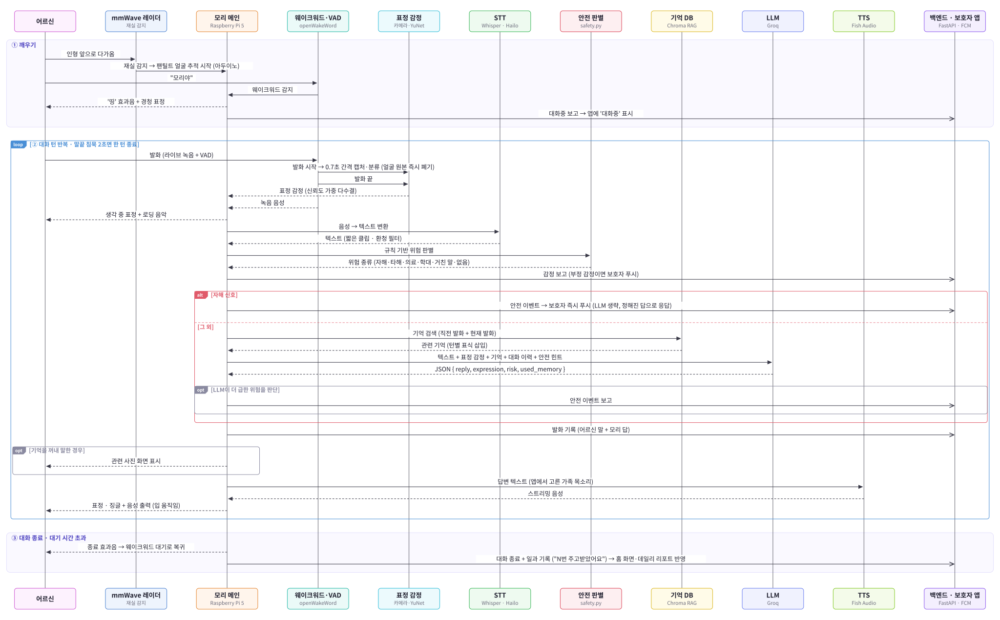
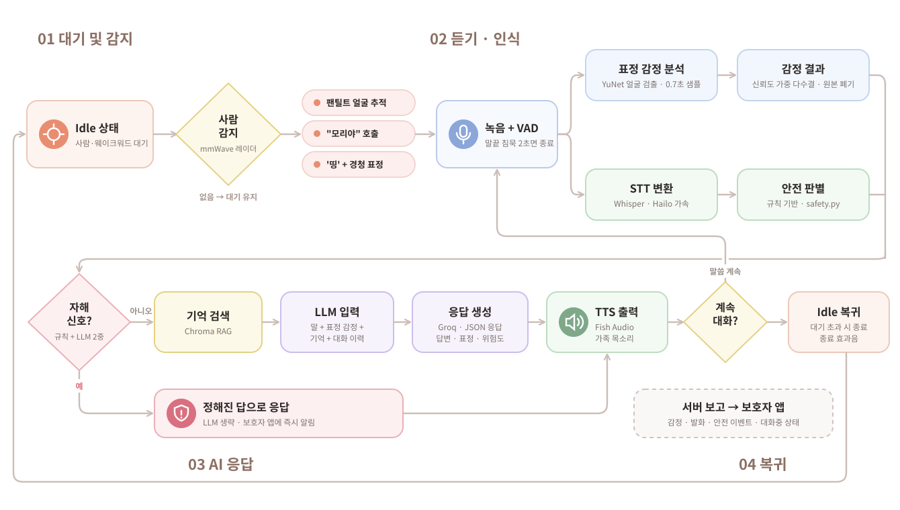

<div align="center">

# 🧸 ReMory Device

**치매 어르신과 가족을 잇는 돌봄 인형, 모리(Mori)의 온디바이스 코드**

"모리야" 하고 부르면 인형이 깨어나 대화를 시작합니다.
듣고 · 알아듣고 · 표정을 읽고 · 기억을 꺼내고 · 가족의 목소리로 대답합니다.

<br/>


</div>

---

## 📖 이런 서비스입니다

치매를 앓는 어르신은 하루 대부분을 혼자 보냅니다. 가족은 멀리 있고,
"오늘 어떠셨어요?" 를 물어볼 방법이 전화밖에 없습니다.

**리모리는 어르신 곁에 인형을 둡니다.** 인형 *모리* 는 어르신과 대화를 나누고,
가족이 남긴 메시지를 **가족의 목소리로** 읽어주고, 약 드실 시간을 알려줍니다.
그 사이에 쌓인 대화·감정·활동은 가족 앱의 홈 화면과 하루 리포트로 정리되어 전달됩니다.

<table>
<tr>
<td width="33%" valign="top">

### 👵 어르신
말벗이 되어주는 인형 **모리**.
"모리야" 하고 부르면 대답하고,
사진 속 추억을 함께 이야기하고,
약 시간을 챙겨줍니다.

</td>
<td width="33%" valign="top">

### 🧸 인형 (Device)
Raspberry Pi 5 + 카메라·마이크·스피커.
대화·감정·활동을 서버에 올리고,
가족 메시지와 어르신 정보(RAG)를
서버에서 받아 갑니다.

</td>
<td width="33%" valign="top">

### 👨‍👩‍👧 가족 (보호자)
Flutter 앱으로 어르신 상태를 보고,
대화방에 메시지·사진을 남기고,
자기 목소리를 등록하고,
데일리 리포트를 받습니다.

</td>
</tr>
</table>

---

## 🗺 시스템 구성

<div align="center">
  
</div>

<br/>

**전체 서비스에서 이 저장소의 자리**

| | 무엇을 하나 | 핵심 |
|---|---|---|
| **① 엣지 · 인형 모리** | 📍 **이 저장소** | Raspberry Pi 5 + AI HAT+ · 카메라/마이크/스피커/LCD<br/>웨이크워드 → STT → 얼굴·표정 감정 인식을 **기기 안에서** 처리 |
| **② AI 처리** | 이해하고 목소리를 만든다 | Groq API(대화 생성) · Fish Audio(TTS·가족 음성 클로닝) |
| **③ AWS 클라우드** | 가족 앱과 인형을 잇는다 | EC2 위의 FastAPI · 패스키 인증 · PostgreSQL · Vector DB(RAG) · S3 |
| **보호자 앱** | 가족이 보는 화면 | Flutter (iOS·Android) → HTTPS REST |

> 🔒 **얼굴 원본은 엣지에서 즉시 폐기하고 감정 라벨만 서버로 보냅니다.**
> 어르신 얼굴 이미지는 네트워크를 타지 않습니다.

> 🔗 백엔드 서버는 [Hanium-Remory/backend](https://github.com/Hanium-Remory/backend) 에 있습니다.

---

## 🔁 동작 흐름

<div align="center">
  
</div>

> **곁에 사람이 있을 때만 듣습니다.** mmWave 레이더(`mmwave.py`)가 아무도 없다고 하면 웨이크워드를 듣지 않고,
> 얼굴 트래커도 정면에서 쉽니다. 사람이 오면 다시 "모리야" 를 기다리고 트래커가 찾기 시작합니다.
> 레이더가 없거나 답이 끊기면 늘 사람이 있는 것으로 보고 그대로 동작합니다.

**동시에 백그라운드에서 도는 것들**

| 워커 | 주기 | 하는 일 |
|---|---|---|
|  `connection_worker` | 300s | "인형이 연결되어 있음"을 서버에 알림 (600s 넘게 끊기면 앱에 '연결 끊김') |
|  `medication_worker` | 30s | 약 시간이 되면 음성 안내 → 활동 기록 → 15분 뒤 복용 확인 |
|  `chat_worker` | 15s | 가족이 보낸 글은 TTS + 알림 카드로, 사진은 화면에 30초 표시 |
|  `settings_worker` | 15s | 볼륨 · 방해 금지 시간 · 기본 목소리(Fish 목소리 모델 ID) 동기화 |
|  `rag_sync_worker` | 300s | 앱에 올라온 사진·추억을 받아 Chroma 증분 갱신 |
|  `conversation_worker` | 이벤트 | 대화 시작/종료 보고를 순서대로 전송 (앱의 '대화중' 표시) |

---

## 🛠 설계에서 신경 쓴 것

- 🔒 **프레임을 모아두지 않습니다.** 발화 중 0.7초 간격으로 캡처해 그 자리에서 바로 분류하고 버립니다. 메모리에 남는 건 라벨별 누적 점수뿐이라, 턴이 끝나도 되돌릴 원본이 없습니다.
- 🎯 **말이 끝난 걸 스스로 압니다.** VAD 오탐 한 프레임에 침묵 카운터가 리셋되지 않도록 "2프레임 이상 연속 음성"일 때만 리셋합니다. 어르신의 느린 말 사이 쉼을 문장 끝으로 오해하지 않습니다.
- 🙉 **환청을 걸러냅니다.** 0.4초 미만 클립은 아예 STT 를 건너뛰고, 결과에 한글이 한 글자도 없으면 버립니다. (`"you"`, `"Thanks for watching"` 같은 Whisper 특유의 무음 환청)
- 🔇 **스피커는 하나뿐입니다.** 대화 TTS · 약 알림 · 가족 메시지가 서로 말을 끊지 않도록 `speaker_lock` 으로 줄을 세우고, 어르신이 말하는 중(`recording`)이면 알림을 그 턴이 끝날 때까지 미룹니다.
- ⏱ **네트워크가 대화를 막지 않습니다.** '대화중' 보고는 큐에 넣고 즉시 돌아오고, TTS 는 청크를 미리 받아 쌓아두고 재생합니다.
- 🚨 **자해 신호는 인터넷이 끊겨도 잡습니다.** 위험 판별을 LLM에만 맡기면, 모델이 그냥 넘어가거나 Groq 호출이 실패했을 때 가족 알림이 에러 하나 없이 조용히 안 갑니다. 그래서 정규식 규칙(safety.py)이 LLM보다 먼저 봅니다
- 🖼 **기억을 꺼내면 그 사진을 보여줍니다.** 대화가 앱에 올라온 사진 기억과 충분히 가까우면(유사도 기준) 답하는 동안 그 사진을 화면에 띄웁니다. 애매하면 띄우지 않습니다.
- 🎵 **생각하는 동안 조용하지 않습니다.** 답을 만드는 사이엔 낮은 로딩 음악을, 말하기 직전엔 표정에 맞춘 1초 남짓한 음악(`bgm/`)을 깝니다.

---

## 🛡 안전 판별

어르신의 말에서 위험 신호를 가려냅니다. **규칙과 LLM 두 겹**으로 봅니다 — 규칙([`safety.py`](safety.py))이 먼저 보고, 규칙이 모르는 낯선 어법은 대화를 만드는 그 LLM 호출에 필드 하나를 얹어 함께 받습니다. 왕복이 늘지 않습니다.

가려낸 뒤 **하는 일은 종류마다 다릅니다.**

| 종류 | 어떻게 대응하나 | 왜 |
|---|---|---|
| 🆘 **자해** | LLM 을 **거치지 않고** 정해진 말로 답하고, 가족에게 **즉시 알림** | 모델이 무슨 말을 할지 모르는 채로 두면 안 되는 자리 |
| 😠 **타해** | 야단치지도, 맞장구치지도 않고 정해진 말로 가라앉힘 | 치매의 공격성은 흔한 증상이고 대개 통증·불편에서 옴 |
| 💊 **의료** | 판단하지 않고 가족·의사에게 넘김 | 약·치료 판단은 인형이 할 일이 아님 |
| 🤐 **학대** | 기록만 남김 | 사실 확인이 안 된 정황. 실시간 알림이 오히려 어르신을 위험하게 만들 수 있음 |
| 💢 **거친 말** | 훈계하지 않고 LLM 에 지침만 얹음 | 탈억제는 증상이지 악의가 아님 |

한 문장에 여러 개가 섞이면 **자해를 가장 먼저** 봅니다. 되돌릴 수 없는 쪽이라 놓쳤을 때 대가가 가장 큽니다.

> 오탐을 특히 신경 써서 걸러냅니다. "힘들어 **죽겠다**"(강조)와 "**죽고 싶다**"(욕구)를 어미로 가르고, "맛이 **죽여주네**"(칭찬)는 타해로 잡지 않습니다. "그 말이 **맞았어**"가 학대로 잡히지 않도록 `맞았` 은 아예 뺐습니다. — [`test_safety.py`](test_safety.py)

---

## 🧰 하드웨어 · 기술 스택

| 영역 | 사용 기술 | 메모 |
|---|---|---|
| **본체** | Raspberry Pi 5 + AI HAT+ 2 (Hailo-10H) | 온디바이스 STT · 포즈 검출 가속 |
| **근접 감지** | mmWave 레이더 (Seeed MR24HPC1 계열, UART) | 2초마다 사람 유무 확인 · 없으면 웨이크워드·트래킹 쉼 |
| **웨이크워드** | openWakeWord + 자체 학습 `moriya_v1.onnx` | CPU 추론, 0.25초 간격 · threshold 0.9 |
| **녹음/VAD** | PyAudio + `webrtcvad` (aggressiveness 2) | RMS 에너지 게이트 병행, 말끝 침묵 2초로 종료 |
| **STT** | Whisper-base `.hef` @ Hailo GenAI | `small.hef` 은 언어 파라미터 무시 버그가 있어 base 사용 · `STT_ENGINE=clova` 면 NAVER CLOVA |
| **감정 인식** | YuNet(얼굴 검출) + 직접 학습 5감정(`emotion_ko5.onnx`) | 모델이 없으면 HSEmotion(AffectNet 8감정) · 0.7초 간격 샘플 → 신뢰도 가중 다수결 |
| **얼굴 트래킹** | Pi 카메라 + YOLOv8 포즈 `.hef` + 아두이노 팬틸트 | Hailo 에서 사람·관절을 찾아 머리 쪽으로 돌림 · 못 열면 Pixy2 팬틸트 + YuNet |
| **RAG** | Chroma + `jhgan/ko-sroberta-multitask` | 안정 ID 기반 증분 동기화 (사진 수백 장도 빠름) |
| **비전 분석** | Gemini 2.5 Flash (선택) | 사진 → 기억 텍스트. 꺼두면 보호자 설명을 그대로 사용 |
| **LLM** | Groq (`openai/gpt-oss-120b`) · `LLM_ENGINE=claude` 면 Claude (`claude-haiku-5-5`) | JSON 으로 `reply` + `expression` 동시 생성 · Claude 는 고정 프롬프트를 캐시 |
| **TTS** | Fish Audio 스트리밍 (`TTS_ENGINE=cosyvoice` 면 CosyVoice2) | 앱에서 고른 Fish 목소리 모델로 말함 · 예전 CosyVoice 목소리면 `FISH_REFERENCE_ID` |
| **얼굴 표시** | WebSocket(8765) → Chromium kiosk + SVG | 표정 6종 · 말할 때 입 움직임 · 웨이크워드 전구 · 알림 카드(약·메시지) · 사진 오버레이 |
| **오디오 출력** | ALSA `aplay` (`plughw:CARD=UACDemoV10`) | 볼륨은 `amixer` 로 서버 설정값 반영 |

---

## 📁 프로젝트 구조

```
main.py              🎯 통합 파이프라인 + 백그라운드 워커 6종
main_fish.py         예전 실행 파일 (이제 main.py 와 같음)
wakeword.py          "모리야" 감지 (openWakeWord 임베딩 → ONNX)
mic_vad.py           라이브 VAD 녹음 (발화 시작/끝 콜백 제공)
mmwave.py            mmWave 레이더로 곁에 사람이 있는지 확인
audio_out.py         스피커 재생 + Fish Audio / CosyVoice2 스트리밍 TTS
conversation_log.py  대화 한 턴을 로컬 JSONL 로 저장 (백엔드가 pull)
safety.py            어르신 말에서 위험 신호를 가려냄 (규칙 + LLM 두 겹)
eval_safety.py       위험 발화 탐지 평가 (규칙 · LLM · 이중화 비교)
test_safety.py       안전 판별 테스트 — 오탐 위주로 검증
test_related_photo.py 대화 관련 사진 찾기 테스트 (임베딩 없이)
test_face_tracker.py 트래킹 제어 루프 시뮬레이션 (하드웨어 없이)
bgm/                 로딩 음악 · 표정별 짧은 음악

yolo26_tracker/
├── tracking_hailo.py  Pi 카메라 → Hailo 포즈 검출 → 아두이노 팬틸트 (기본 트래커)
└── webcam_preview.py  노트북 웹캠으로 같은 추적 화면 보기 (파이 없이)

stt/
├── stt4vad_hat.py   Hailo Whisper STT + 환청 필터
└── stt_clova.py     NAVER CLOVA STT (STT_ENGINE=clova)

emotion/
├── config.py        모델 경로 · 카메라 · 감정 라벨(한글 매핑)
├── vision.py        카메라 캡처 → YuNet 검출 → 감정 분류
├── face_crop.py     얼굴 검출·crop·전처리 (인형과 학습 스크립트가 같이 씀)
├── emotion_service.py  발화 구간 동안 샘플링 → 다수결 라벨
├── webcam_emotion.py 노트북 웹캠으로 두 감정 모델 비교 (파이 없이)
├── train/           직접 학습 5감정 모델 학습 스크립트
├── face_tracker.py  얼굴 위치 → PD 제어 → Pixy2 팬틸트 (백그라운드)
├── pixy_servo.py    Pixy2 서보·색 블록 래퍼 (libpixyusb2)
├── pixy_camera.py   Pixy2 센서 영상 → BGR (Pi 카메라 대신)
└── pixy2_raw_frame.patch  libpixyusb2 파이썬 바인딩에 영상 받기 추가

rag/
├── retriever.py       기억 검색 + LLM 컨텍스트 문자열 생성
├── rag_sync.py        백엔드 데이터 → Chroma 증분 동기화
└── image_processor.py 사진 → Gemini Vision → 기억 데이터

face/
├── face_display_2.py  WebSocket 서버 (표정·전구·알림·사진 명령)
├── mori_face.html     브라우저에 그려지는 모리 얼굴 (SVG)
├── preview.html       모리 얼굴 미리보기
└── start_face.sh      부팅 때 키오스크로 얼굴 화면 띄우기
```

---

## 🚀 실행하기

### 1. 시스템 패키지

```bash
sudo apt update
sudo apt install -y python3-pyaudio portaudio19-dev alsa-utils mpg123 chromium-browser
```

> Hailo 런타임(`hailo-all`)과 `picamera2` 는 Raspberry Pi OS 에 맞춰 미리 설치되어 있어야 합니다.

### 2. 파이썬 환경

```bash
git clone https://github.com/Hanium-Remory/Hanium-Remory-HW.git
cd Hanium-Remory-HW

python3 -m venv .venv --system-site-packages   # picamera2/hailo 시스템 패키지 사용
source .venv/bin/activate
pip install numpy sounddevice pyaudio webrtcvad onnxruntime openwakeword soundfile \
            requests python-dotenv groq anthropic websockets opencv-python hsemotion-onnx \
            langchain-chroma langchain-huggingface google-genai pyserial
```

### 3. 모델 파일 배치

```
models/
├── moriya_v1.onnx        웨이크워드 (자체 학습)
├── melspectrogram.onnx   ← 첫 실행 시 자동 다운로드
├── embedding_model.onnx  ← 첫 실행 시 자동 다운로드
├── yunet.onnx            얼굴 검출
├── emotion_ko5.onnx      직접 학습 5감정 (있으면 이걸 씀)
└── enet_b0_8_best_afew.onnx  HSEmotion 8감정 (예비)
```

Whisper `.hef` 는 `stt/stt4vad_hat.py` 의 `hef_path` 기본값(`/home/han/hailo_models/whisper-base.hef`)을,
트래커의 포즈 모델은 `/usr/share/hailo-models/yolov8m_pose_h10.hef` 를 씁니다.
HSEmotion 모델이 `models/` 에 없으면 첫 실행 때 `~/.hsemotion/` 로 자동 내려받습니다.

### 4. `.env`

```bash
GROQ_API_KEY=...                  # 대화 생성
# LLM_ENGINE=claude               # 기본 groq. claude 면 아래 키 사용
# ANTHROPIC_API_KEY=...
# CLAUDE_MODEL=claude-haiku-5-5   # 기본값
# CLAUDE_EFFORT=low               # low|medium|high. 높을수록 느리고 깊게 생각
GEMINI_API_KEY=...                # (선택) 사진 비전 분석
RAG_USE_VISION=false              # true 로 켜면 사진을 Gemini 로 분석

REMORY_API=https://<백엔드 주소>
DEVICE_ID=1
DEVICE_TOKEN=...                  # 앱에서 인형 등록 시 발급받은 기기 토큰

TTS_ENGINE=fish                   # 기본 fish. cosyvoice 면 아래 TTS_STREAM_* 사용
FISH_API_KEY=...
FISH_REFERENCE_ID=...             # (선택) 앱 목소리가 Fish 모델이 아닐 때 쓸 기본 목소리
FISH_MODEL=s2.1-pro-free          # 안 정하면 유료 모델로 가서 크레딧이 없으면 402

# TTS_STREAM_API_URL=http://<TTS 서버>:8001/tts_stream   # TTS_ENGINE=cosyvoice 일 때만
# TTS_API_KEY=...

STT_ENGINE=hailo                  # clova 면 CLOVA_CLIENT_ID · CLOVA_CLIENT_SECRET 필요
TRACK_BACKEND=hailo               # pixy 면 Pixy2 팬틸트
MMWAVE_PORT=/dev/ttyAMA0          # MMWAVE_ENABLED=false 로 끌 수 있음

AUDIO_CONTROL=PCM                 # amixer scontrols 로 확인
CONVERSATION_LOG_DIR=./conversations
```

### 5. 실행

```bash
python main.py
```

얼굴 화면은 따로 띄웁니다.

```bash
chromium --kiosk face/mori_face.html
```

부팅 때 자동으로 띄우려면 `face/start_face.sh` 를 `~/.config/autostart/` 에 등록합니다.

### 6. 테스트

```bash
python test_safety.py          # 안전 판별
python test_related_photo.py   # 대화 관련 사진 찾기
python test_face_tracker.py    # Pixy2 트래킹 제어 루프
```

안전 판별이 위험한 말을 잡는지, **멀쩡한 말을 위험으로 오해하지 않는지** 확인합니다.
평가 세트로 규칙·LLM 성능을 재려면 `python eval_safety.py eval_set.csv` (`--no-llm` 이면 규칙만).

---

## 🎯 얼굴 트래킹

모리가 말하는 어르신 쪽으로 고개를 돌립니다. 얼굴이 화면 가운데 있으니 감정 샘플도 잘리지 않습니다.

### 기본: Hailo 포즈 + 아두이노 팬틸트 (`TRACK_BACKEND=hailo`)

```
Pi 카메라 → YOLOv8 포즈(.hef, Hailo) → 사람·코·눈·귀 위치 → 아두이노(/dev/ttyACM0)로 팬·틸트 각도
                                       └→ 따라가는 사람의 얼굴만 crop → 감정 분류
```

카메라는 트래커가 열고, 감정 인식은 그 화면과 '지금 따라가는 사람' 얼굴 위치를 받아 씁니다.
사람이 없으면(mmWave) 정면에서 쉬고, 웨이크워드가 들렸는데 아무도 못 잡았으면 빠르게 둘러봅니다.
`TRACK_STREAM_PORT=8000` 을 주면 `http://<파이 IP>:8000` 에서 추적 화면을 볼 수 있습니다.
노트북에서는 `python yolo26_tracker/webcam_preview.py` 로 웹캠만으로 같은 화면을 볼 수 있습니다.

트래커를 못 열면 아래 Pixy2 방식으로 넘어갑니다.

### 대안: Pixy2 팬틸트 (`TRACK_BACKEND=pixy`)

**Pixy2 칩은 사람을 못 알아봅니다.** Pixy2 는 '색 덩어리'만 찾는 칩이라 사람 형태를 인식하지 못합니다.
그래서 Pixy2 센서 영상을 파이로 받아와 파이에서 얼굴을 찾습니다.

```
Pixy2 켜짐 → 센서 영상(316x208) → YuNet 얼굴 검출 → 팬틸트로 얼굴을 가운데로
                                  └→ 같은 영상에서 얼굴 crop → 감정 분류
```

| | 하는 일 |
|---|---|
| **Pixy2 센서** | 영상을 USB 로 보낸다 (`CAMERA_SOURCE=pixy`, 기본) — Pixy 프로그램은 멈춘 상태 |
| **YuNet** | 얼굴이 화면 어디 있는지 찾는다 (감정 인식과 같은 영상·같은 검출기) |
| **Pixy2 서보** | 팬틸트를 돌린다 (`set_servos`, 0~1000) |

영상 받기는 공식 바인딩에 없어서 패치가 필요합니다(아래 빌드 참고). 패치 안 된 모듈이거나 Pixy2 를 못 열면
Pi 카메라로 자동으로 넘어갑니다. 316x208 이라 1~2m 떨어진 얼굴은 작게 잡힙니다 — 감정 정확도가 떨어지면
`CAMERA_SOURCE=picam` 으로 Pi 카메라를 쓰세요. `cd emotion && python pixy_camera.py` 로 한 장 찍어 fps·화질을 확인할 수 있습니다.

**Pi 카메라를 쓸 때(`CAMERA_SOURCE=picam`): Pi 카메라를 Pixy2 와 같은 틸트 플레이트에, 렌즈 바로 아래에 붙입니다.**
모터가 돌면 카메라도 같이 돌기 때문에, 카메라 화면 속 얼굴을 가운데로 맞추는 것만으로 추적이 됩니다(폐루프).
두 렌즈가 같은 방향을 보도록 평행하게, 리본 케이블은 팬 회전 범위만큼 여유를 둡니다
(Pi 5 는 22핀 → 15핀 변환 케이블, 30cm 이상 권장).

`TRACK_SOURCE=pixy` 로 바꾸면 Pixy2 가 PixyMon 에서 학습한 색(시그니처 1~3 — 피부색이나 색 마커)을 직접 따라갑니다.
조명·배경에 민감해서 기본값은 `face` 입니다. Pixy2 영상을 카메라로 쓰는 동안에는 색 블록이 안 나와서 `face` 로 동작합니다.

#### Pixy2 파이썬 모듈 빌드 (파이에서 한 번)

```bash
sudo apt install -y git swig libusb-1.0-0-dev g++ python3-dev python3-setuptools
git clone https://github.com/charmedlabs/pixy2.git ~/pixy2
cd ~/pixy2 && git apply <이 저장소>/emotion/pixy2_raw_frame.patch   # 영상 받기(video_get_frame) 추가
cd ~/pixy2/scripts && ./build_libpixyusb2.sh && ./build_python_demos.sh
cp ~/pixy2/build/python_demos/pixy.py ~/pixy2/build/python_demos/_pixy*.so  <이 저장소>/emotion/
```

> `build_python_demos.sh` 는 `python` 명령을 씁니다. 없으면 `sudo apt install python-is-python3`.
> sudo 없이 USB 에 접근하려면 Pixy2 udev 규칙을 추가하세요. 모듈이나 Pixy2 가 없으면 트래킹만 꺼지고 대화는 그대로 됩니다.

#### 방향·게인 맞추기

```bash
cd emotion && python face_tracker.py      # 트래킹만 단독 실행
```

| 증상 | 조치 (`.env` 또는 `emotion/config.py`) |
|---|---|
| 얼굴 반대쪽으로 고개가 돌아감 | 그 축만 `PAN_DIR=-1` / `TILT_DIR=-1` |
| 카메라를 거꾸로 달았음 | `CAM_HFLIP=true` `CAM_VFLIP=true` (감정 모델은 똑바른 얼굴이 필요) |
| 가운데서 덜덜 떨림 · 모터 소리 | `TRACK_DEADBAND` 키우기, `PAN_KP`/`TILT_KP` 낮추기 |
| 따라가는 게 느림 | `PAN_KP`/`TILT_KP` 올리기 (떨리기 시작하면 다시 내림) |
| 트래킹을 끄고 싶음 | `TRACK_ENABLED=false` |

```bash
python test_face_tracker.py   # 하드웨어 없이 제어 루프 수렴·부호 검증
```

---

## 🔌 백엔드와 주고받는 것

모든 요청에 `X-Device-Token` 헤더를 붙입니다.

| 방향 | 엔드포인트 | 언제 |
|---|---|---|
| 올림 | `PATCH /devices/{id}/heartbeat` | 5분마다 |
| 올림 | `PATCH /devices/{id}/conversation` | 대화 시작/종료 |
| 올림 | `POST /devices/{id}/emotions` | 발화마다 감정 라벨 |
| 올림 | `POST /devices/{id}/activities` | 약 알림 등 활동 기록 |
| 올림 | `POST /devices/{id}/utterances` | 대화 한 턴 (어르신 말 + 모리 답) |
| 올림 | `POST /devices/{id}/safety-events` | 위험 신호 — 자해는 서버가 받는 즉시 가족에게 알림 |
| 받음 | `GET /devices/{id}/medications` | 약 시간표 · 복용 확인 여부 |
| 받음 | `GET /devices/{id}/settings` | 볼륨 · 등록된 목소리 · 기본 목소리 |
| 받음 | `GET /devices/{id}/dnd` | 방해 금지 시간대 |
| 받음·올림 | `GET /devices/{id}/chat/pending` → `POST .../chat/delivered` | 가족 메시지를 받아 전한 뒤, 전달했다고 알림 |
| 받음 | `GET /devices/{id}/memories` | 어르신 프로필 · 가족 · 사진 추억 (RAG 원본) |

대화 내용은 **두 곳에 남습니다.** 서버로는 턴이 끝날 때마다 `POST /utterances` 로 올리고,
동시에 `conversations/{환자ID}/{날짜}.jsonl` 에 append-only 로도 쌓습니다.
네트워크가 끊겨도 대화가 사라지지 않고, 백엔드가 나중에 파일에서 가져갈 수 있습니다.
(환자 데이터이므로 `.gitignore` 로 커밋을 막아두었습니다.)
